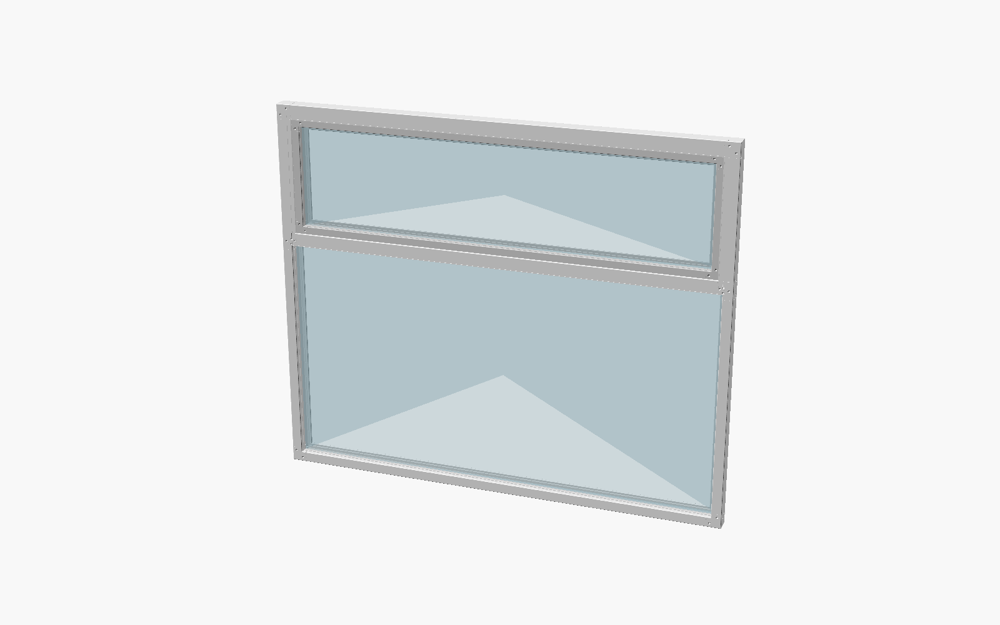
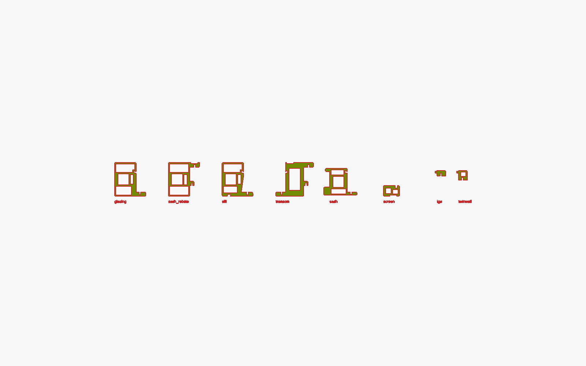
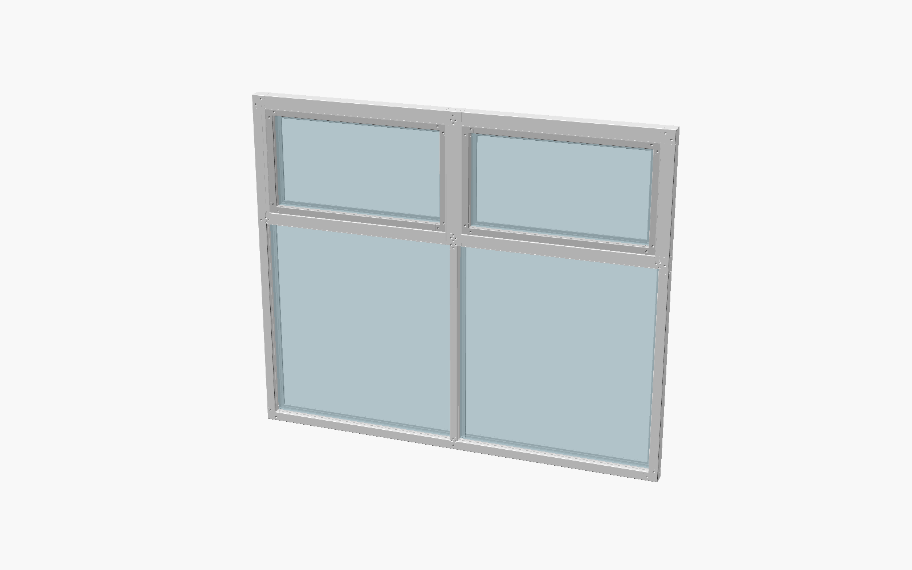
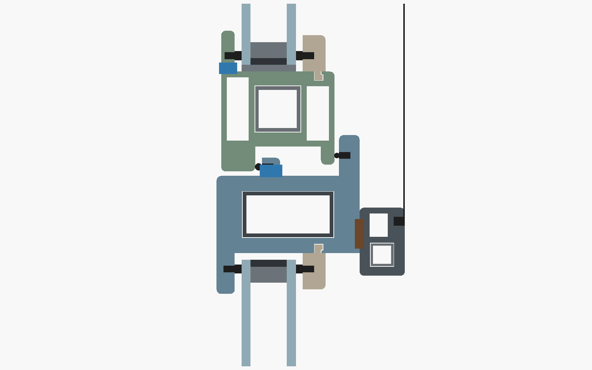

# OpenWindow

A mostly 3D-printable replacement window for basic single-glazed aluminium sliders.
v1: top awning over a fixed double-glazed pane, brick-veneer walls, Bambu P1S-sized parts.

Printed shell segments slide over continuous metal tubes: 20 × 20 aluminium in the frame and sash, and a 40 × 20 steel tube in the transom. Every cross-section comes from `cad/profile.scad`:

Too big for your glass sheet? `params/home-1800x1500-2bay.json` is the same opening with `"max_pane": [1200, 900]`: two bays, split by a mullion.

## Documents

- Design spec: [docs/specs/2026-10-07-diy-window-design.md](docs/specs/2026-10-07-diy-window-design.md) (§12 lists the amendments)
- Implementation plan: [docs/plans/2026-10-08-diy-window-v1.md](docs/plans/2026-10-08-diy-window-v1.md)
- [Printing](docs/printing.md): material tier, printer settings, orientation
- [Build guide](docs/build-guide.md): bench assembly of the frame, transom, mullions, each bay's sash and screen
- [Install guide](docs/install-guide.md): fitting the window into a brick-veneer opening
- [Test log](docs/test-log.md): bench-window tests to pass before the full-size build (with bays, on a two-bay bench window too; with V-slot cores, rows 10–12 as well)
- [Owner's manual](docs/user-manual.md): operation, cleaning, maintenance, troubleshooting and safety for a finished window
- [OpenWindow-Guide.pdf](OpenWindow-Guide.pdf): the whole job as a slide deck (sizing, printing, assembly, installation, owner's manual, BOM, tests). Rebuild it with `python3 pdf/build_deck.py`; its illustrations come from `cad/deck/*.scad` via `cad/box.sh png`, and `python3 pdf/render_deck.py` re-renders all of them from `pdf/deck_renders.txt` after a geometry change
- [Web configurator](web/README.md): a local page that sizes and checks a window as you type, renders its parts on the Windows box and zips everything for that opening (`python3 web/server.py`)

## Quick start (bench window)

    python3 tools/generate.py params/bench-600.json   # layout, part wrappers and checks -> cad/generated/
    cad/box.sh render bench-600                       # renders and checks every STL -> cad/stl/bench-600/
    python3 bom/build_bom.py bench-600                # bom/bench-600.md, .csv, -parts.csv, -cutlist.csv, -glass.csv

Run the tests with `cd tools && python3 -m unittest discover -p 'test_*.py'` (Python), `python3 -m unittest discover -s web/tests -p 'test_*.py'` (web configurator) and `cad/box.sh test` (OpenSCAD asserts).

## Your own opening

**Before printing anything full-size:** confirm you can buy a friction-stay pair that fits the sash cavity. It needs a stack height of 13 mm or less, a track/arm width of 14 mm or less, and a rating of at least the sash weight that `generate.py` prints. Many 400 mm awning stays are 16–19 mm wide, and those won't fit (spec §11).

1. **Measure** the opening (brick reveal to brick reveal, and head to brick sill) at three points each way, and use the smallest values. Check the timber reveal is at least 63 mm deep. Install guide step 2 has the details.
2. **Copy a params file:** `cp params/home-1800x1500.json params/my-window.json`. Then edit it:
   - `name`: must match the file name (`my-window`);
   - `opening_w`, `opening_h`: your measurements;
   - `fix_gap`: the gap to the brickwork on each side, 6–10 mm;
   - `awning_h`: at least 150;
   - `glazing`: `igu`, `acrylic` or `twinwall`;
   - `acrylic_t`, `acrylic_gap` (optional, acrylic only, default 4 and 16): panel thickness (2-6 mm) and air gap (8-16 mm) of the acrylic sandwich. Panels + gap must fit the 24 mm glazing pocket; a thinner sandwich gets deeper beads to fill it. Thinner panels make the sash lighter and cheaper, but don't save plastic, and a gap under 16 mm insulates a little less;
   - `tier`: 1–3, picked from [printing](docs/printing.md);
   - `screen` (optional, default `true`): `false` leaves out the insect screen, its parts and its hardware;
   - `bed` (optional, default `[256, 256, 256]`, a Bambu P1S): your printer's build volume X, Y, Z in mm. Segments are split to at most min(Z, max(X, Y)) − 16 mm.
   - `max_pane` (optional, no limit by default): the largest glass or acrylic sheet you can get, `[a, b]` in mm, either way round. The window is split into the fewest equal bays, divided by mullions, that make every pane fit. Each bay has its own fixed pane, awning sash and screen.
   - `bays` (optional): more bays than `max_pane` needs, or a number of bays on its own, with no `max_pane`. Fewer than `max_pane` needs is an error.
   - `core` (optional): `"vslot"` builds the cores from V-slot 2020 extrusion, with M5 T-nuts, joins in the head, sill and lower jambs, and a cut plan in the BOM. The transom and mullions become two 2020s side by side. A member that can't be V-slot keeps its standard tube, and the `core` check line says why. That happens when it is longer than your pieces and no join is allowed, or too flexible, like the 1.8 m transom.
   - `vslot_stock` (optional, with `core`, default 1000): the length of your V-slot pieces, 300-6000 mm.
3. **Generate:** `python3 tools/generate.py params/my-window.json`. Read the check lines it prints (transom deflection, friction-stay rating, segment length, with `max_pane` or `bays` the pane fit and mullion deflection, and with `core` the tube cores). A `WARNING` line needs a change before you print.
4. **Render:** `cad/box.sh render my-window` writes the STLs to `cad/stl/my-window/` and checks each one against the part list.
5. **BOM:** `python3 bom/build_bom.py my-window` writes the following to `bom/`:
   - `my-window.md`: BOM, tube cut list and glass sizes;
   - `my-window-parts.csv`: the print list;
   - `my-window-cutlist.csv`;
   - `my-window-glass.csv`.

   Build from these per-name files. `cad/generated/` only holds the last window generated, and `cad/box.sh test` and `png` regenerate it for the bench window.
6. **Print, build and install** with the three guides above.

## Rendering on your own machine

`cad/box.sh` runs OpenSCAD (nightly 2026.10.02 or later, manifold backend) on a Windows machine over SSH and SCP:

- `BOX_HOST=user@host cad/box.sh render my-window` picks the machine. The default is the author's build box.
- `cad/box.sh ping` prints `ok` when the box answers over SSH, and exits 255 when it doesn't. The web configurator's box indicator uses it.
- The remote work folder (`REMOTE`, `WREMOTE`) and the OpenSCAD path (`SCAD`) are set at the top of `cad/box.sh`. Edit them for your machine.
- Every `ssh`/`scp` call binds `en0` (`-B en0`, `BindInterface=en0`) to get around the author's VPN. Remove those options if your network doesn't need them.

Or skip `box.sh`: open each `cad/generated/parts/<ID>.scad` in your own OpenSCAD, export it to `cad/stl/<name>/<ID>.stl`, then run `python3 tools/check_stl.py <name>` and the BOM step.
